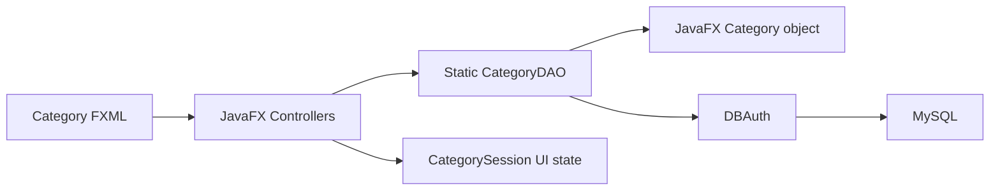
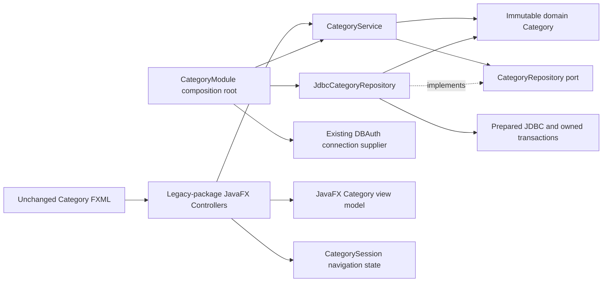

# Implemented architecture — Phase 4A

## Scope and rationale

Sobol remains one Maven-built JavaFX desktop application. Category is the first migrated vertical slice because its active workflows (list/search/select, create, edit and navigation to Products) are small enough to verify without redesigning inventory or sales transactions. The other business modules retain their existing implementation. No backend, web client, framework, generic repository hierarchy or multi-module build was introduced.

The architecture below is **implemented** for Category. Applying it to other modules is a future decision, not work completed in this phase.

## Before

```text
src/main/java/application/
  Category.java                  JavaFX properties also used as DAO data
  CategoryDAO.java               static JDBC, duplicate checks, booleans/empty lists on failure
  CategoryController.java        UI plus DAO coordination
  AddCategoryController.java     UI validation, duplicate lookup, insert
  EditCategoryController.java    UI validation, duplicate lookup, update
  CategorySession.java           static navigation state
  DBAuth.java                    guarded development connection boundary
```



Business validation was mixed with presentation. Duplicate lookup and subsequent write were separate operations; lookup failures could look like no duplicate. updateCategory ignored affected rows and could report success for an absent target. Static DAO coupling required controller overrides to isolate business operations in Phase 3A tests.

## Actual resulting structure

```text
src/main/java/
  application/                                  existing presentation/legacy package
    CategoryController.java                     list/search/select/navigation
    AddCategoryController.java                  create form, service call, feedback
    EditCategoryController.java                 edit target snapshot, service call, feedback
    Category.java                               detached mutable JavaFX view model
    CategorySession.java                        presentation navigation compatibility
    CategoryModule.java                         no-argument FXML composition root
    DBAuth.java                                 unchanged legacy infrastructure boundary
    ...                                         remaining legacy modules unchanged
  com/sobol/category/
    domain/Category.java                        immutable persisted business representation
    application/CategoryRepository.java         persistence port used by the service
    application/CategoryService.java            list/create/update use cases and validation
    application/CategoryException.java          typed, sanitized application failures
    infrastructure/JdbcCategoryRepository.java  prepared SQL, mapping, transactions, SQL errors
src/main/resources/application/
  Category.fxml, AddCategory.fxml, EditCategory.fxml   unchanged location/content/controllers
src/test/java/
  com/sobol/category/application/CategoryServiceTest.java
  com/sobol/category/infrastructure/JdbcCategoryRepositoryTest.java
  com/sobol/category/CategoryArchitectureTest.java
  application/ControllerRepairsDesktopTest.java
  application/CorePersistenceIT.java
```

No existing controller or FXML was moved. CategoryDAO was deleted after all production callers and its one Integration Test caller were migrated. Its unused delete/next-ID/preflight-check helpers had no active callers or UI action; no compatibility DAO is retained solely for an unused API. Git/provenance retain the original source evidence.

## Change inventory

| Change | Exact files (relative to the repository root) |
| --- | --- |
| Added production | `src/main/java/com/sobol/category/domain/Category.java`; `src/main/java/com/sobol/category/application/CategoryService.java`, `CategoryRepository.java`, `CategoryException.java`; `src/main/java/com/sobol/category/infrastructure/JdbcCategoryRepository.java`; `src/main/java/application/CategoryModule.java` |
| Modified production | `src/main/java/application/Category.java`, `CategoryController.java`, `AddCategoryController.java`, `EditCategoryController.java` |
| Removed production | `src/main/java/application/CategoryDAO.java` |
| Added tests | `src/test/java/com/sobol/category/application/CategoryServiceTest.java`; `src/test/java/com/sobol/category/infrastructure/JdbcCategoryRepositoryTest.java`; `src/test/java/com/sobol/category/CategoryArchitectureTest.java` |
| Modified tests | `src/test/java/application/ControllerRepairsDesktopTest.java`, `CorePersistenceIT.java` |
| Added documentation | `docs/ARCHITECTURE.md` |
| Updated documentation | `README.md`; `docs/VERIFICATION.md`, `KNOWN-DEFECTS.md`, `RECOVERY.md`, `DEVELOPMENT-DATABASE.md` |

No files were moved. FXML/CSS/images, pom.xml/dependency versions, historical migration, DBAuth and unrelated production modules are unchanged in Phase 4A.

## Dependencies and composition



The application layer depends on the domain and its own persistence port. Infrastructure depends inward on that port/domain. Neither inner layer imports JavaFX, JDBC, the legacy application package or infrastructure. JDBC does not import the legacy presentation package: CategoryModule supplies `DBAuth::get` through its small checked connection function. DBAuth is unchanged, so production connections retain its fail-closed, loopback/sobol_dev restrictions. A supplier must return a fresh connection owned by the repository; never supply another operation's active transaction.

CategoryModule is the sole production wiring location for this slice. Each public no-argument controller constructor obtains a service there, preserving FXMLLoader compatibility. Package-visible constructors accept the real CategoryService with a test repository; no business method is overridden to fake success in Category controller tests. UI alert/navigation callbacks remain overridable for isolated GUI tests. Composition is deliberately explicit, without a DI container or service locator shared across modules.

JDK jdeps verified the compiled slice: domain uses java.base; application uses domain/java.base; infrastructure uses application/domain/java.sql/java.base. No reverse dependencies/cycles are present in this slice. Small source-boundary tests guard the intended imports and detached view mapping. This single artifact has no JVM-enforced module boundary; the tests are not a complete architectural dependency analyzer.

## Domain, application and presentation responsibilities

- Domain Category is an immutable record with a positive persisted ID, a required trimmed name limited to the historical VARCHAR(150) character capacity, and optional description normalized to an empty string. Supplementary Unicode characters are counted as code points, not UTF-16 units. Invalid legacy persisted data produces a visible storage failure; it is not silently rewritten.
- CategoryService validates ID/name before writes, normalizes descriptions, returns immutable list snapshots, and distinguishes invalid input, invalid ID, duplicate name, missing persisted target and storage failure. It has no session, UI, clock or connection state.
- CategoryRepository contains only the active list/create/update persistence operations. Uniqueness is a write contract enforced by the database UNIQUE key, including a race with another writer; an earlier UI lookup is not treated as authoritative. In-memory tests approximate uniqueness but do not reproduce MySQL's full accent/case collation semantics.
- `application.Category.fromDomain()` copies immutable domain values into independent JavaFX properties. Editing those properties cannot change a stored domain object. Form fields are UI state; save submits ID/name/description to the service. The selected edit ID remains captured independently of display/session/model changes, preserving the Phase 3A fix.
- Controllers handle FXML, cards/filtering, navigation and human feedback. Validation/duplicate/storage decisions come from the service/repository boundary. The existing UI layout, FXML controller names and handler names remain intact. New distinct feedback identifies a target deleted while editing instead of navigating away as if saved.

## Persistence correctness and transactions

Create owns a transaction: INSERT must report one row, generated identity must be available, domain mapping must succeed, then commit. Failures roll back; a missing key cannot produce a success.

Update owns a transaction:

1. SELECT category_id WHERE category_id=? FOR UPDATE.
2. If absent, roll back/release locks and return empty; the service emits NOT_FOUND.
3. If present, issue the parameterized UPDATE against that ID. Accept only 0 or 1 as the returned count.
4. Commit and return the updated domain object. Zero is valid for unchanged existing values because existence was established under a lock; no concurrent delete can remove the locked row before this transaction completes.

Connector/J defaults to found/matched-row reporting (`useAffectedRows=false`); changed-row mode can return zero for an unchanged record. The code supports both rather than equating zero with missing. The actual driver/server handshake and locking behavior are **not live-verified** here. See [Connector/J connection properties](https://docs.oracle.com/cd/E17952_01/connector-j-en/connector-j-connp-props-connection.html) and [MySQL locking reads](https://dev.mysql.com/doc/refman/8.4/en/innodb-locking-reads.html).

Error code 1062 for these category name writes maps to DUPLICATE_NAME. Other SQL failures, malformed persisted data, unexpected row counts and failed rollback map to STORAGE_FAILURE. Driver messages/causes, query parameter values and connection configuration are not passed into UI-facing exceptions or logged by the repository. Resources use try-with-resources; failure paths explicitly attempt rollback. A commit/disconnect failure can leave the outcome unknown; the message says the operation could not be confirmed. There is no automatic retry or claim that rollback reverses an already committed transaction.

No schema, UNIQUE constraint, DBAuth setting, SalesDAO/ShipmentDAO or inventory behavior changed. Category update locks apply only to the Category row, not to inventory or the entire application. Concurrent edits still have last-writer semantics; no new optimistic version column or conflict policy is invented.

## Compatibility boundaries and remaining debt

The physical legacy application package still mixes presentation and other old infrastructure. Only Category's new core has clean module/layer boundaries. `application.Category` remains the existing view model, not a second domain entity. CategorySession is deliberately retained because ProductsController and AddProductController consume its navigation selection; neither CategoryService nor the domain depends on it. Resource/navigation compatibility is not an endorsement of static global UI state for the eventual whole system.

Other modules still use static DAOs and controller business logic. UI I/O remains synchronous on the JavaFX thread. There is no generalized transaction manager, pool, centralized authorization or enterprise exception/logging system. Live MySQL setup, credential rotation confirmation, collation, lock/commit semantics and Integration Tests remain outstanding. Authentication, stock/capacity races, shipment form defects and missing features remain in KNOWN-DEFECTS.md.

## How later modules should follow this pattern (not implemented)

Choose one bounded module, enumerate its actual consumers, introduce only its domain data/invariants and application port/use cases, implement its JDBC mapping with explicit write outcomes, then migrate UI callers using constructor injection plus a small composition root. Retain adapters only for concrete unmigrated consumers, with a named removal condition. Preserve FXML resource paths unless explicitly migrating every reference. Verify domain/use cases with fakes, JDBC failure/row-count contracts with scripted proxies, FXML behavior with real JavaFX controls, and real SQL separately in sobol_dev. Do not copy unused Category abstractions into other modules or reorganize the remaining sources wholesale.

Supplier is a reasonable next candidate: bounded CRUD/validation and lookup consumers can be separated before touching purchasing or inventory transactions. This is a recommendation requiring a later approval, not a started migration.
