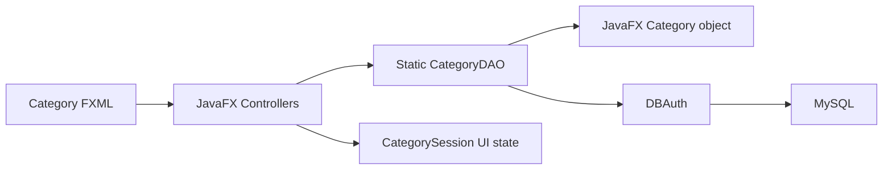
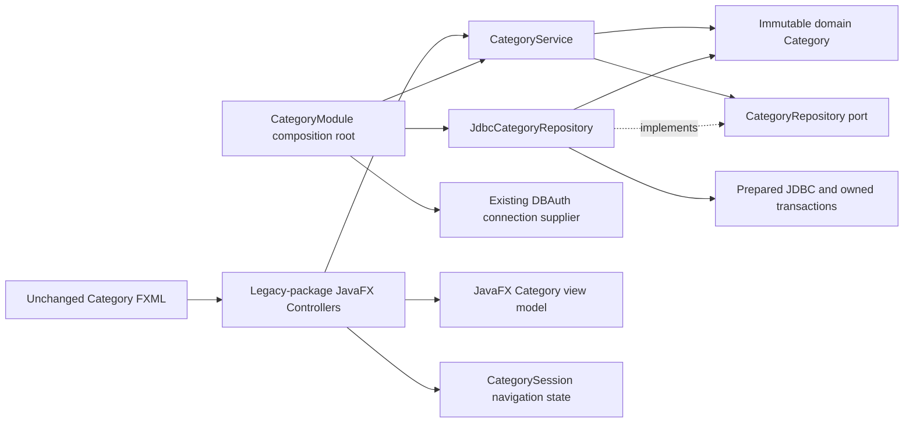
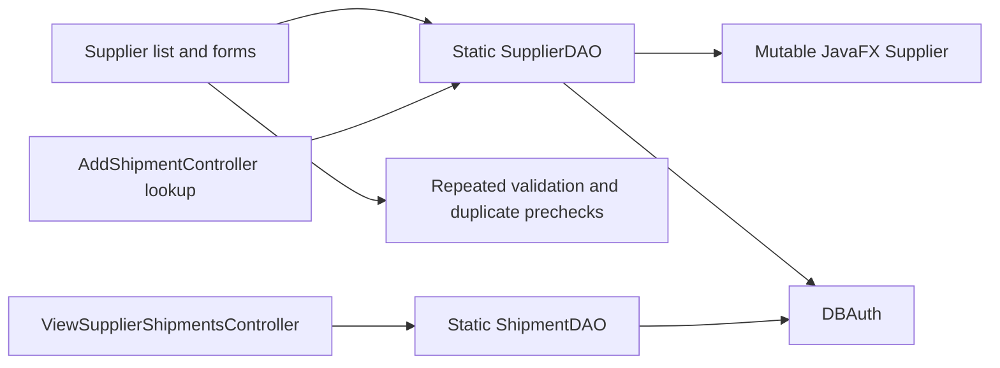
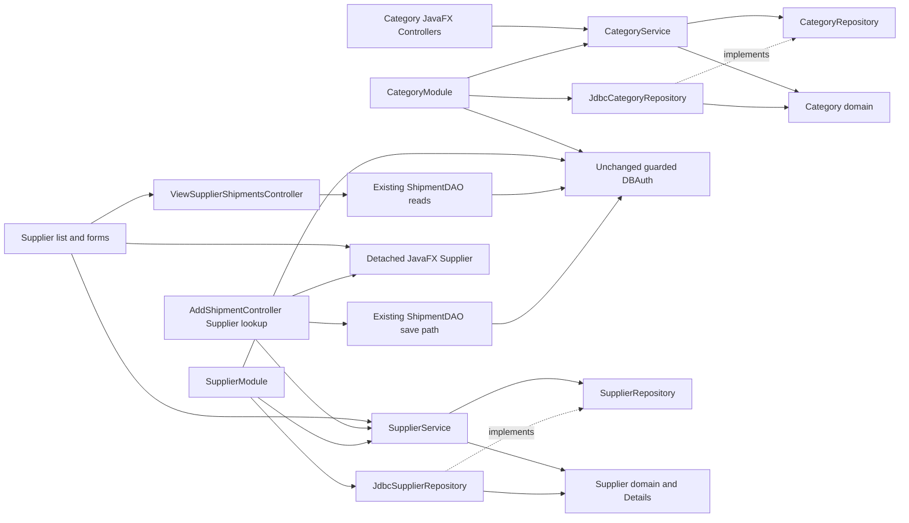
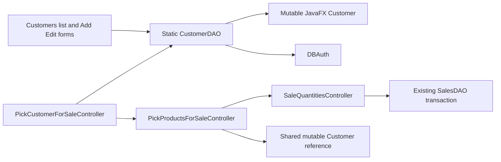
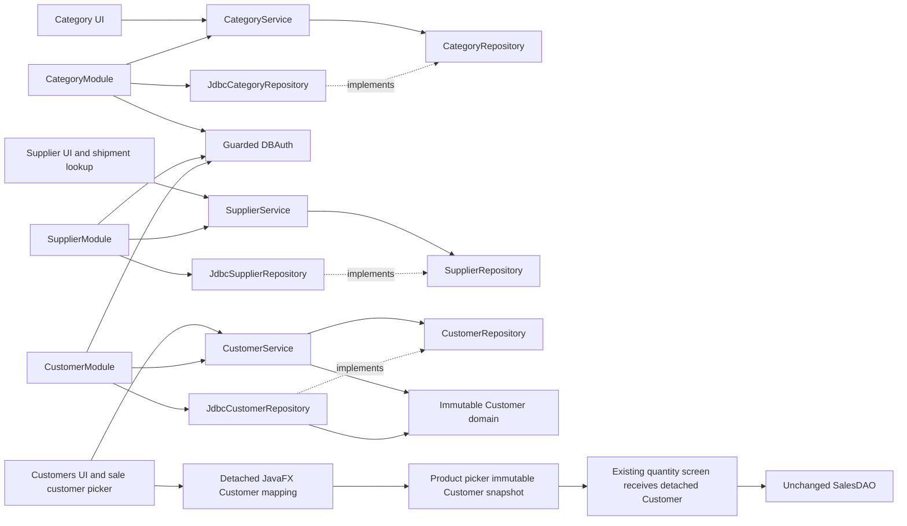

# Current direction ? PostgreSQL transition, Phase 6A

The owner's Phase 6A decision supersedes the MySQL-specific architecture descriptions below. This section describes the current foundation; lower Phase 4 sections are retained historical design records, not current database setup instructions.

PostgreSQL JDBC is the sole production database driver. PostgresDatabase is an explicit numeric-loopback/sobol_dev/sobol boundary, with verified TLS and dedicated identity/privilege checks. Retired DBAuth.get always throws before opening a connection. All legacy DAO/UI source is retained for coherent future migration; it cannot reach MySQL or borrow PostgreSQL connections. Existing login is not migrated and no bypass is added; this is not a production-ready functional cutover.

Test-scoped PostgresMigrations delegates version/checksum/locking/DDL execution to Flyway only after a separate explicit migration approval. The owner creates the dedicated empty database/schema/roles only after a separately reviewed approval; no setup runs on startup or ordinary verify. V1 contains only three independent master-data tables. At this foundation commit, the three repository composition roots still await their individually tested PostgreSQL migrations; no production slice acceptance is claimed.

See [POSTGRESQL-MODEL.md](POSTGRESQL-MODEL.md) for implemented-vs-deferred schema/ERD, design assumptions and full dependency closures; [POSTGRESQL-SETUP.md](POSTGRESQL-SETUP.md) for safety and owner preparation. Historical MySQL SQL/test machinery is non-executable reference under reference/mysql. Original business SQL is not mechanically translated to a redesigned stock schema.

---

# Implemented architecture — Category (4A), Supplier (4B), Customer (4C)

## Scope and rationale

Sobol remains one Maven-built JavaFX desktop application. Category was the first migrated vertical slice (list/search/select, create, edit and navigation to Products); Supplier followed (CRUD and shipment supplier lookup). Customer is now the third (CRUD and customer lookup for sales), preserving the existing sales transaction boundary. Other business modules retain their existing implementation. No backend, web client, framework, generic repository hierarchy or multi-module build was introduced.

The architecture below is **implemented** for Category, Supplier and Customer. Their domain/application/infrastructure packages are independent; no core imports another slice. Applying this direction to further modules requires separate approval.

## Category before Phase 4A

```text
src/main/java/application/
  Category.java                  JavaFX properties also used as DAO data
  CategoryDAO.java               static JDBC, duplicate checks, booleans/empty lists on failure
  CategoryController.java        UI plus DAO coordination
  AddCategoryController.java     UI validation, duplicate lookup, insert
  EditCategoryController.java    UI validation, duplicate lookup, update
  CategorySession.java           static navigation state
  DBAuth.java                    guarded development connection boundary
```



Business validation was mixed with presentation. Duplicate lookup and subsequent write were separate operations; lookup failures could look like no duplicate. updateCategory ignored affected rows and could report success for an absent target. Static DAO coupling required controller overrides to isolate business operations in Phase 3A tests.

## Actual resulting structure

```text
src/main/java/
  application/                                  existing presentation/legacy package
    CategoryController.java                     list/search/select/navigation
    AddCategoryController.java                  create form, service call, feedback
    EditCategoryController.java                 edit target snapshot, service call, feedback
    Category.java                               detached mutable JavaFX view model
    CategorySession.java                        presentation navigation compatibility
    CategoryModule.java                         no-argument FXML composition root
    SuppliersController.java                    Supplier list/filter/select/navigation
    AddSupplierController.java                  Supplier create form and service feedback
    EditSupplierController.java                 Supplier edit target snapshot and service feedback
    Supplier.java                               detached mutable JavaFX view model
    SupplierModule.java                         Supplier composition, including shipment lookup
    AddShipmentController.java                  SupplierService lookup; other shipment code unchanged
    ViewSupplierShipmentsController.java        selected ID snapshot and legacy ShipmentDAO reads
    Customer.java                               detached JavaFX mapping to/from immutable domain
    CustomerModule.java                         Customer CRUD/sale-lookup composition
    CustomersController.java                    Customer list/filter/select/edit navigation
    AddCustomerController.java                  service-backed creation and feedback
    EditCustomerController.java                 edit ID snapshot, prefill and service feedback
    PickCustomerForSaleController.java          service-backed lookup and detached selected handoff
    PickProductsForSaleController.java          immutable selected Customer; legacy product reads
    SalesController.java                        unchanged sale entry with narrow navigation/read delegates
    DBAuth.java                                 unchanged legacy infrastructure boundary
    ...                                         remaining legacy modules unchanged
  com/sobol/category/
    domain/Category.java                        immutable persisted business representation
    application/CategoryRepository.java         persistence port used by the service
    application/CategoryService.java            list/create/update use cases and validation
    application/CategoryException.java          typed, sanitized application failures
    infrastructure/JdbcCategoryRepository.java  prepared SQL, mapping, transactions, SQL errors
  com/sobol/supplier/
    domain/Supplier.java                        immutable identity, nested Details value/field invariants
    application/SupplierRepository.java         active persistence port
    application/SupplierService.java            list/create/update use cases and typed validation
    application/SupplierException.java          safe typed outcomes
    infrastructure/JdbcSupplierRepository.java  prepared SQL, mapping, transactions and failures
  com/sobol/customer/
    domain/Customer.java                        immutable ID and nested Details value
    application/CustomerRepository.java         persistence port with typed conflict semantics
    application/CustomerService.java            list/create/update and centralized validation
    application/CustomerException.java          safe name/email/validation/missing/storage outcomes
    infrastructure/JdbcCustomerRepository.java  SQL, generated IDs, locks, constraint discrimination
src/main/resources/application/
  Category.fxml, AddCategory.fxml, EditCategory.fxml   unchanged location/content/controllers
  Suppliers.fxml, AddSupplier.fxml, EditSupplier.fxml unchanged location/content/controllers
  ViewSupplierShipments.fxml, AddShipment.fxml        unchanged location/content/controllers
  Customers.fxml, AddCustomer.fxml, EditCustomer.fxml unchanged location/content/controllers
  PickCustomerForSale.fxml, PickProductsForSale.fxml  unchanged location/content/controllers
  Sales.fxml, SaleQuantities.fxml                    unchanged location/content/controllers
src/test/java/
  com/sobol/category/application/CategoryServiceTest.java
  com/sobol/category/infrastructure/JdbcCategoryRepositoryTest.java
  com/sobol/category/CategoryArchitectureTest.java
  application/ControllerRepairsDesktopTest.java
  application/CorePersistenceIT.java
  com/sobol/supplier/application/SupplierServiceTest.java
  com/sobol/supplier/infrastructure/JdbcSupplierRepositoryTest.java
  com/sobol/supplier/SupplierArchitectureTest.java
  application/SupplierDesktopTest.java
  com/sobol/customer/application/CustomerServiceTest.java
  com/sobol/customer/infrastructure/JdbcCustomerRepositoryTest.java
  com/sobol/customer/CustomerArchitectureTest.java
  application/CustomerDesktopTest.java
```

No existing controller or FXML was moved. CategoryDAO was deleted after all production callers and its one Integration Test caller were migrated. Its unused delete/next-ID/preflight-check helpers had no active callers or UI action; no compatibility DAO is retained solely for an unused API. Git/provenance retain the original source evidence.

## Historical Phase 4A change inventory

| Change | Exact files (relative to the repository root) |
| --- | --- |
| Added production | `src/main/java/com/sobol/category/domain/Category.java`; `src/main/java/com/sobol/category/application/CategoryService.java`, `CategoryRepository.java`, `CategoryException.java`; `src/main/java/com/sobol/category/infrastructure/JdbcCategoryRepository.java`; `src/main/java/application/CategoryModule.java` |
| Modified production | `src/main/java/application/Category.java`, `CategoryController.java`, `AddCategoryController.java`, `EditCategoryController.java` |
| Removed production | `src/main/java/application/CategoryDAO.java` |
| Added tests | `src/test/java/com/sobol/category/application/CategoryServiceTest.java`; `src/test/java/com/sobol/category/infrastructure/JdbcCategoryRepositoryTest.java`; `src/test/java/com/sobol/category/CategoryArchitectureTest.java` |
| Modified tests | `src/test/java/application/ControllerRepairsDesktopTest.java`, `CorePersistenceIT.java` |
| Added documentation | `docs/ARCHITECTURE.md` |
| Updated documentation | `README.md`; `docs/VERIFICATION.md`, `KNOWN-DEFECTS.md`, `RECOVERY.md`, `DEVELOPMENT-DATABASE.md` |

No files were moved. FXML/CSS/images, pom.xml/dependency versions, historical migration, DBAuth and unrelated production modules are unchanged in Phase 4A.

## Dependencies and composition



The application layer depends on the domain and its own persistence port. Infrastructure depends inward on that port/domain. Neither inner layer imports JavaFX, JDBC, the legacy application package or infrastructure. JDBC does not import the legacy presentation package: CategoryModule supplies `DBAuth::get` through its small checked connection function. DBAuth is unchanged, so production connections retain its fail-closed, loopback/sobol_dev restrictions. A supplier must return a fresh connection owned by the repository; never supply another operation's active transaction.

CategoryModule is the sole production wiring location for this slice. Each public no-argument controller constructor obtains a service there, preserving FXMLLoader compatibility. Package-visible constructors accept the real CategoryService with a test repository; no business method is overridden to fake success in Category controller tests. UI alert/navigation callbacks remain overridable for isolated GUI tests. Composition is deliberately explicit, without a DI container or service locator shared across modules.

JDK jdeps verified the compiled slice: domain uses java.base; application uses domain/java.base; infrastructure uses application/domain/java.sql/java.base. No reverse dependencies/cycles are present in this slice. Small source-boundary tests guard the intended imports and detached view mapping. This single artifact has no JVM-enforced module boundary; the tests are not a complete architectural dependency analyzer.

## Domain, application and presentation responsibilities

- Domain Category is an immutable record with a positive persisted ID, a required trimmed name limited to the historical VARCHAR(150) character capacity, and optional description normalized to an empty string. Supplementary Unicode characters are counted as code points, not UTF-16 units. Invalid legacy persisted data produces a visible storage failure; it is not silently rewritten.
- CategoryService validates ID/name before writes, normalizes descriptions, returns immutable list snapshots, and distinguishes invalid input, invalid ID, duplicate name, missing persisted target and storage failure. It has no session, UI, clock or connection state.
- CategoryRepository contains only the active list/create/update persistence operations. Uniqueness is a write contract enforced by the database UNIQUE key, including a race with another writer; an earlier UI lookup is not treated as authoritative. In-memory tests approximate uniqueness but do not reproduce MySQL's full accent/case collation semantics.
- `application.Category.fromDomain()` copies immutable domain values into independent JavaFX properties. Editing those properties cannot change a stored domain object. Form fields are UI state; save submits ID/name/description to the service. The selected edit ID remains captured independently of display/session/model changes, preserving the Phase 3A fix.
- Controllers handle FXML, cards/filtering, navigation and human feedback. Validation/duplicate/storage decisions come from the service/repository boundary. The existing UI layout, FXML controller names and handler names remain intact. New distinct feedback identifies a target deleted while editing instead of navigating away as if saved.

## Persistence correctness and transactions

Create owns a transaction: INSERT must report one row, generated identity must be available, domain mapping must succeed, then commit. Failures roll back; a missing key cannot produce a success.

Update owns a transaction:

1. SELECT category_id WHERE category_id=? FOR UPDATE.
2. If absent, roll back/release locks and return empty; the service emits NOT_FOUND.
3. If present, issue the parameterized UPDATE against that ID. Accept only 0 or 1 as the returned count.
4. Commit and return the updated domain object. Zero is valid for unchanged existing values because existence was established under a lock; no concurrent delete can remove the locked row before this transaction completes.

Connector/J defaults to found/matched-row reporting (`useAffectedRows=false`); changed-row mode can return zero for an unchanged record. The code supports both rather than equating zero with missing. The actual driver/server handshake and locking behavior are **not live-verified** here. See [Connector/J connection properties](https://docs.oracle.com/cd/E17952_01/connector-j-en/connector-j-connp-props-connection.html) and [MySQL locking reads](https://dev.mysql.com/doc/refman/8.4/en/innodb-locking-reads.html).

Error code 1062 for these category name writes maps to DUPLICATE_NAME. Other SQL failures, malformed persisted data, unexpected row counts and failed rollback map to STORAGE_FAILURE. Driver messages/causes, query parameter values and connection configuration are not passed into UI-facing exceptions or logged by the repository. Resources use try-with-resources; failure paths explicitly attempt rollback. A commit/disconnect failure can leave the outcome unknown; the message says the operation could not be confirmed. There is no automatic retry or claim that rollback reverses an already committed transaction.

No schema, UNIQUE constraint, DBAuth setting, SalesDAO/ShipmentDAO or inventory behavior changed. Category update locks apply only to the Category row, not to inventory or the entire application. Concurrent edits still have last-writer semantics; no new optimistic version column or conflict policy is invented.

## Compatibility boundaries and remaining debt

The physical legacy application package still mixes presentation and other old infrastructure. Category, Supplier and Customer have clean core boundaries; their JavaFX controllers still live in that legacy package. `application.Category` remains the existing view model, not a second domain entity. CategorySession is deliberately retained because ProductsController and AddProductController consume its navigation selection; neither CategoryService nor the domain depends on it. Customer introduces no global session/selection. Resource/navigation compatibility is not an endorsement of static global UI state for the eventual whole system.

Other modules still use static DAOs and controller business logic. UI I/O remains synchronous on the JavaFX thread. There is no generalized transaction manager, pool, centralized authorization or enterprise exception/logging system. Live MySQL setup, credential rotation confirmation, collation, lock/commit semantics and Integration Tests remain outstanding. Authentication, stock/capacity races, shipment form defects and missing features remain in KNOWN-DEFECTS.md.

## Supplier before Phase 4B



SupplierDAO returned partial/empty lists on exceptions, duplicate prechecks returned false on failures, and create/update returned booleans that collapsed duplicate/storage outcomes. updateSupplier treated only positive counts as success, so an unchanged record could fail in changed-row mode. Supplier editing already passed the selected object and captured its ID; this behavior is preserved and now rejects invalid/uninitialized targets. Name/phone/email checks and trimming were duplicated across both forms; VARCHAR limits were not checked before persistence.

## Supplier implemented dependencies and cross-module boundaries



SupplierModule is the only Supplier production wiring location. It creates the real service/repository with `DBAuth::get`, preserving fail-closed loopback/sobol_dev access. Four consumers have public no-argument FXML constructors and package-visible service-injection constructors. Infrastructure receives only a checked function returning a fresh owned Connection; it never imports application.DBAuth. Domain depends only on java.base; Application depends inward on Domain; java.sql appears only in Infrastructure. Existing Category source/tests remain unchanged. jdeps checks both compiled slices, in addition to their architecture tests.

`application.Supplier.fromDomain()` is a detached presentation adapter. No static SupplierDAO compatibility adapter remains: all its consumers were migrated before deletion. The existing mutable JavaFX Supplier and FXML controller names remain for table/ComboBox compatibility; their removal would require an explicit migration of those bindings, not another DAO wrapper.

| Consumer | Actual migrated behavior / retained boundary |
| --- | --- |
| SuppliersController | Service list -> detached JavaFX rows; existing name/phone/city filtering; selection required for Edit/View; FXMLLoader passes selected Supplier before display. Read failure explicitly alerts rather than pretending there are no suppliers. |
| AddSupplierController | Raw form fields -> service.createSupplier; typed validation/conflict/storage feedback; return only on success or Cancel. |
| EditSupplierController | Captured positive selected ID and null-safe optional prefill -> service.updateSupplier; missing/conflict/storage errors stay on form; subsequent display/model ID mutation cannot retarget the save. |
| AddShipmentController | Only Supplier integration changed: service list -> existing ComboBox<Supplier>, preserve IDs/names and first selection; clear stale selection before loading; distinguish empty supplier list from storage failure. Existing branch/warehouse/product/payment/calculation/save logic is retained. |
| ViewSupplierShipmentsController | Snapshot selected ID; original ShipmentDAO.getShipmentsBySupplier/getTotalCostBySupplier remain behind narrow package-visible test delegates. Existing table mappings/totals/Back navigation retained. This is a legacy Shipment integration, not a new Supplier persistence implementation. |
| CorePersistenceIT | Supplier round trip uses SupplierService; Customer is also service-backed in Phase 4C. Three Supplier cases still cover create/null mapping/unique conflicts, unchanged and missing target. The current suite has 25 compiled methods, none run against MySQL. |

DashboardDAO counts, ReportsDAO supplier-spend aggregations and ShipmentDAO joins still query the supplier table as legacy cross-module read models. They never called SupplierDAO or consumed Supplier domain objects. They are intentionally unchanged; migrating Supplier CRUD does not claim complete purchasing/reporting separation. ShipmentDAO.addShipment still receives the selected supplier ID through its original form data. Its FK/stock transaction is unchanged.

## Supplier validation, persistence and compatibility

Supplier is an immutable positive ID plus a nested immutable Details value. Details is the single implementation of field invariants, shared by writes and persisted mapping; it is not a second mutable business model. Service converts safe domain field identities into typed SupplierException reasons before repository writes. Domain/Application contain no JavaFX/JDBC/session state.

| Field | Historical schema and implemented rule |
| --- | --- |
| name | Required trimmed nonblank, at most 150 characters; database uq_supplier_name remains authoritative. |
| phone | Required trimmed nonblank, at most 30; no new numeric-only format or uniqueness restriction. |
| email | Optional, at most 150; preserve the original `^[A-Za-z0-9+_.-]+@[A-Za-z0-9.-]+$` expectation, including its permissive single-label host. No invented stricter email rule or uniqueness. |
| city / address / contact_person / notes | Optional, limits 100 / 255 / 150 / 400 respectively. |

All seven strings retain historical trim behavior. Empty/blank optional values become null, matching the old DAO's setNull behavior; nonblank Unicode lengths count code points. No new schema constraint, phone/email uniqueness or created_at mapping is added. created_at remains the database default, absent from the original active forms/models. Invalid persisted contact data raises a safe storage error; reading never repairs/re-writes data. Schema-valid but historically nonconforming email data may therefore prevent listing until separately reviewed, which is a visible compatibility risk rather than silent data loss.

Repository findAll uses the original descending supplier_id order with prepared SELECT, maps all eight active columns, closes resources, and raises STORAGE_FAILURE on connection/query/mapping failure. It starts no explicit transaction. insert binds seven fields (SQL NULL for optional nulls), requires one inserted row and a valid generated key, maps the identity before commit, and explicitly attempts rollback on failure. This transaction prevents reporting/persisting an unconfirmed identity as a successful create.

update uses an owned transaction and `SELECT supplier_id ... FOR UPDATE`; absent target returns empty/NOT_FOUND without executing UPDATE. A locked existing row accepts only 0 or 1 as the update count, supporting unchanged values and matched-row reporting while preventing a concurrent delete between existence check and write. It commits before returning success. No extra availability query, name precheck or transaction is wrapped around list/filter operations. Names are unique at the database write boundary; code 1062 maps to DUPLICATE_NAME. Other failures, invalid mapping, abnormal row counts and failed rollback map to STORAGE_FAILURE. Read/open/close failures are never classified as duplicate-name availability results. SQL diagnostics, parameters and driver causes are neither logged nor exposed through the service exception. A commit/disconnect failure remains unconfirmed and is never automatically retried.

Supplier editing remains last-writer-wins. Live MySQL collation, locks, affected rows and commit ambiguity are not proven by proxies. ViewSupplierShipments still inherits ShipmentDAO's silent failure/empty-total behavior and separate list/total reads; it is not an atomic analytics snapshot. AddShipment.fxml still lacks cbMethod/rbCash/rbCredit; its known save defect is unchanged. Supplier lookup tests load its real FXML and actual Supplier loader while replacing unrelated static Branch/Warehouse initialization; they do not verify complete shipment startup/save.

## Phase 4B exact change inventory

| Change | Exact repository-relative files |
| --- | --- |
| Added production | `src/main/java/com/sobol/supplier/domain/Supplier.java`; `src/main/java/com/sobol/supplier/application/SupplierService.java`, `SupplierRepository.java`, `SupplierException.java`; `src/main/java/com/sobol/supplier/infrastructure/JdbcSupplierRepository.java`; `src/main/java/application/SupplierModule.java` |
| Modified production | `src/main/java/application/Supplier.java`, `SuppliersController.java`, `AddSupplierController.java`, `EditSupplierController.java`, `AddShipmentController.java`, `ViewSupplierShipmentsController.java` |
| Removed production | `src/main/java/application/SupplierDAO.java` |
| Added tests | `src/test/java/com/sobol/supplier/application/SupplierServiceTest.java`; `src/test/java/com/sobol/supplier/infrastructure/JdbcSupplierRepositoryTest.java`; `src/test/java/com/sobol/supplier/SupplierArchitectureTest.java`; `src/test/java/application/SupplierDesktopTest.java` |
| Modified tests | `src/test/java/application/CorePersistenceIT.java` |
| Modified documentation | `README.md`; `docs/ARCHITECTURE.md`, `VERIFICATION.md`, `KNOWN-DEFECTS.md`, `DEVELOPMENT-DATABASE.md` |

No files were moved. All FXML/CSS/icons, Category source/tests, pom.xml, DBAuth, SalesDAO, ShipmentDAO, ProductDAO, V001, recovery records and provenance manifests are unchanged in Phase 4B. No historical source/backup was touched, no dependency upgraded, and no database connected.

## Customer before Phase 4C and full dependency closure



Before editing callers, inspection established four production CustomerDAO consumers: CustomersController (DAO getAllCustomers); AddCustomerController (DAO nameExists/emailExists/insertCustomer); EditCustomerController (DAO nameExistsForEdit/emailExistsForEdit/updateCustomer); PickCustomerForSaleController (DAO getAllCustomers). CorePersistenceIT was the only test caller. The Customer view model additionally flowed into PickProductsForSaleController.setCustomer and SaleQuantitiesController.setData before SalesDAO.createOrder consumed its ID. CustomerDAO had no other required API consumers. All were migrated before deletion; no compatibility DAO is retained.

ControllerSystem and Dashboard navigation remain unchanged. SalesController opens the picker from New Order. DashboardDAO/ReportsDAO customer counts and SalesDAO customer joins are independent legacy read models, not missed CustomerDAO consumers; they remain unchanged. SyntheticFixture seeds/cleans owned customer and sales IDs and remains unchanged. The existing disabled Customers View action and the picker double-click preview hint have no implementation; Phase 4C does not invent them.

## Three implemented slices and Customer-to-Sales boundary



Each slice has its own small root, port and domain rules. Roots inject DBAuth::get; no repository imports DBAuth or the legacy application package. Customer domain/application depend on java.base and their own inner types only; java.sql and diagnostic parsing are confined to Infrastructure. Five Customer architecture/mapping tests plus existing Category/Supplier tests and compiled jdeps checks verify these boundaries. This remains one artifact with test-enforced package boundaries, not JVM modules.

CustomerModule wires the real service into all four no-argument FXML controllers; package-visible constructors accept the real service with a fake repository. application.Customer.fromDomain/toDomain map all seven fields into independent view/domain values. No second business validation implementation exists in forms; the immutable nested Details is shared by service validation and repository mapping. Controllers retain presentation filtering, FXML, selection, navigation and typed human feedback.

## Customer rules and persistence semantics

| Field | Implemented historical contract |
| --- | --- |
| customer_id | Positive persisted identity; invalid ID differs from missing valid target. |
| full_name | Required trimmed nonblank, VARCHAR(150), uq_customer_name remains authoritative. |
| phone | Required trimmed nonblank, VARCHAR(30), no new phone format/uniqueness rule. |
| email | Optional VARCHAR(180), uq_customer_email; preserve the original predicate: contains @ and dot, with first @ before last dot. Unusual previously accepted strings remain accepted; no Supplier regex is substituted. |
| city / address / notes | Optional VARCHAR(100) / VARCHAR(220) / VARCHAR(400). Trim non-null values; preserve null versus empty strings. Only blank email becomes SQL NULL, matching the original CustomerDAO. |

Lengths count Unicode code points. Required whitespace-only values are rejected; optional non-email Unicode whitespace retains historical trim behavior. created_at remains the database default, absent from the original active model/forms. Invalid persisted data becomes an explicit storage failure; no automatic repair, SQL migration, phone uniqueness or historical data rewrite occurs. Persisted legacy email data outside the historical form predicate can prevent listing and requires separate review.

findAll preserves customer_id DESC and maps all active columns using prepared SQL/resource ownership, with no explicit read transaction. Create owns a transaction: exactly one inserted row, a positive generated ID and successful mapping before commit. Update owns one connection/transaction for SELECT customer_id FOR UPDATE and UPDATE; absent target returns NOT_FOUND, while counts 0/1 on a locked existing target succeed. Unexpected counts fail closed. There is no check-then-write uniqueness assumption or extra availability transaction. Edits remain last-writer-wins.

Unlike the single-UNIQUE Category/Supplier slices, Customer must distinguish name from non-null email conflicts. Only code 1062 from executeUpdate is classified, using the known final key token uq_customer_name/uq_customer_email (optionally customer/schema qualified). The duplicate value is never used to infer the field, including values containing misleading key text. Unknown/PRIMARY/other-table keys, absent/localized diagnostics, read/connection/commit errors map to STORAGE_FAILURE. This bounded parser follows the [MySQL error reference](https://dev.mysql.com/doc/mysql-errors/8.0/en/server-error-reference.html); actual Connector/J/server/localization compatibility is unverified. The database UNIQUE constraints remain the enforcement authority even when concurrent writers race; no diagnostic is displayed or retained as a cause.

All write failures explicitly attempt rollback. Rollback failure and uncertain commit/connection-close outcomes return safe storage failure with no automatic retry. Typed errors are recreated after the outer connection scope closes so JDBC suppressed exceptions cannot escape through the application exception. Scripted tests cover that path as well as a close failure after a recorded successful commit; the latter is reported as unconfirmed, not falsely described as rolled back. Extending this resource-close failure coverage across older slices remains a follow-up, not a claim that it was performed here.

## Actual Customer/Sales navigation and compatibility verification

Customers.fxml has no direct start-sale action. The retained path is Customers management -> existing navigation to Sales -> New Order -> PickCustomerForSale -> Select Customer -> PickProductsForSale. The management-list selection is not global and does not silently preselect a sale customer. Tests first select an unrelated management row, open Sales in the same content area, and fire its actual New Order handler. The system-wide menu/Dashboard loaders are unchanged and are not dynamically exercised in this fixture.

The picker requires a current positive selected row, snapshots Customer before destination loading, and passes it through the existing setCustomer API. The product picker converts it immediately to immutable domain state, displays that snapshot's name, and later gives SaleQuantities a new detached JavaFX Customer. Source row mutation during FXML loading, source selection changes, later mutation of the setter argument and stale management state cannot retarget this sale or change its displayed identity. Back returns to a fresh picker with no stale selection; the picker Back still opens Sales.

Only compatibility/test seams changed in the Sales presentation: PickProductsForSaleController retains the immutable customer and delegates product reads/navigation; SalesController delegates its existing order read/navigation. Default delegates call the same SalesDAO methods/FXML. Product selection, quantity calculations, employee lookup, SaleQuantitiesController and SalesDAO are unchanged. Real FXML tests substitute only legacy order/product reads, modal feedback and the SaleQuantities.setData boundary; they do not execute sales persistence or financial calculations. Customer Add/Edit success and Cancel now have real return-to-list FXML regression coverage with synthetic repository reloads.

## Phase 4C exact change inventory and limitations

| Change | Exact repository-relative files |
| --- | --- |
| Added production | `src/main/java/com/sobol/customer/domain/Customer.java`; `src/main/java/com/sobol/customer/application/CustomerService.java`, `CustomerRepository.java`, `CustomerException.java`; `src/main/java/com/sobol/customer/infrastructure/JdbcCustomerRepository.java`; `src/main/java/application/CustomerModule.java` |
| Modified production | `src/main/java/application/Customer.java`, `CustomersController.java`, `AddCustomerController.java`, `EditCustomerController.java`, `PickCustomerForSaleController.java`, `PickProductsForSaleController.java`, `SalesController.java` |
| Removed production | `src/main/java/application/CustomerDAO.java` |
| Added tests | `src/test/java/com/sobol/customer/application/CustomerServiceTest.java`; `src/test/java/com/sobol/customer/infrastructure/JdbcCustomerRepositoryTest.java`; `src/test/java/com/sobol/customer/CustomerArchitectureTest.java`; `src/test/java/application/CustomerDesktopTest.java` |
| Modified tests | `src/test/java/application/CorePersistenceIT.java` |
| Modified documentation | `README.md`; `docs/ARCHITECTURE.md`, `VERIFICATION.md`, `KNOWN-DEFECTS.md`, `DEVELOPMENT-DATABASE.md` |

All previous 22 IT methods remain compiled; the original Customer round-trip and duplicate-email assertions now use typed service results and additionally verify unchanged persisted data after conflict. Three Customer methods add missing/unchanged updates and create/read/null/empty/name/email conflict acceptance. The current 25 live IT methods have not run. No original accounts database, private data or backup was accessed. All FXML/resources, Category/Supplier sources and tests, DBAuth, SalesDAO, ShipmentDAO, ProductDAO, SaleQuantitiesController, V001, build/dependency configuration and recovery/provenance files remain unchanged. Counts/results and known runtime limits are recorded in VERIFICATION.md.

Remaining debt includes synchronous UI I/O, unmigrated static DAOs and mixed legacy packaging, mutable downstream Sales UI state, lack of whole-application authorization, last-writer edits, and unverified live SQL/diagnostic/locking behavior. No Branch, Inventory or Sales architectural migration has started.

## How later modules should follow this pattern (not implemented)

Choose one bounded module, enumerate its actual consumers, introduce only its domain data/invariants and application port/use cases, implement its JDBC mapping with explicit write outcomes, then migrate UI callers using constructor injection plus a small composition root. Retain adapters only for concrete unmigrated consumers, with a named removal condition. Preserve FXML resource paths unless explicitly migrating every reference. Verify domain/use cases with fakes, JDBC failure/row-count contracts with scripted proxies, FXML behavior with real JavaFX controls, and real SQL separately in sobol_dev. Do not copy unused Category abstractions into other modules or reorganize the remaining sources wholesale.

The recommended next engineering phase is a controlled verification/security pass: extend resource-close sanitization contracts to older slices and prepare the documented secure sobol_dev acceptance environment with the owner. No such work starts automatically. Live acceptance is still required before claims about server persistence; inventory, sales and purchasing transactions should not be redesigned from offline evidence alone.
