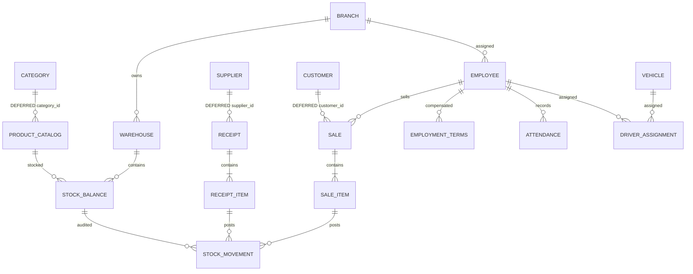

# PostgreSQL target model — Phase 6A

## Authority and implementation boundary

The owner's Phase 6A decision makes PostgreSQL the target. The historical 14-table MySQL schema is evidence of former workflows, not a business specification. This document is the design reference for the transition. Only the three master-data tables in V1 are implemented; their server acceptance remains pending an approved PostgreSQL environment. All other entities below are deferred design, not executable migrations or delivered functionality.

One Maven/JavaFX application remains. No backend, ORM, web frontend or DI framework is added. PostgreSQL JDBC 42.7.14 is production infrastructure. Flyway 13.12.1 core/PostgreSQL support is test-scoped tooling, not a startup action. Version availability was checked against Maven Central and official release notes. Target verification is PostgreSQL 16–18; no installed server version is assumed or tested here.

## Assessment of the existing workflow contracts

The assessment covers all production database entry points, their SQL and direct callers; the source tree/FXML contracts were inventoried recursively. Legacy DAO method bodies, authentication, receiving/sales calculations, attendance defaults and master-data service/repository contracts were traced. Historical sources/private backups and the original database were not accessed. This is static dependency assessment plus offline tests, not proof of full original runtime behavior.

| Workflow and actual path | Historical schema/query problem | Required dependency closure before PostgreSQL activation |
| --- | --- | --- |
| Main -> Signin/Controller1.onLogin/onRegister -> DBAuth; ControllerSystem -> Dashboard | SHA-256 password verification, Gmail-only validation, direct UI SQL, no authenticated authorization boundary. user_database has no active production caller and no user FK. | Account service/password KDF/session/authorization plus login/register/navigation tests; retire per-user database mapping. No auth records or hashes will be transferred. No login bypass is introduced. |
| BranchesController/AddBranch/EditBranch -> BranchDAO; Warehouses/Add/Edit -> WarehouseDAO | branch stores warehouses_count and total_pallet_capacity; caller-supplied deletion/capacity deltas can drift. Duplicate name indexes repeat the same branch invariant; warehouse names have UI-only checks. | Branch/warehouse services/models/forms and summaries; derived COUNT(warehouse_id)/SUM(capacity), uniqueness within branch and transactional capacity reduction rules. |
| CategoryController/Add/Edit -> CategoryService -> JdbcCategoryRepository | Historical vendor error 1062 and broad collation assumptions; product navigation still uses CategorySession. | Category CRUD migrates independently; Category -> Products remains a legacy boundary and DBAuth cannot open PostgreSQL. |
| Products/Add/Edit/View -> ProductDAO; WarehouseViewDAO plus DashboardDAO/ReportsDAO | Product combines catalog identity, branch, warehouse, quantity, min/max and money. Separate branch/warehouse FKs permit mismatched pairs; capacity precheck and write are separate. WarehouseViewDAO uses CEIL(integer/integer), COUNT(*) after LEFT JOIN and MySQL INTERVAL ? DAY. | Catalog + per-warehouse stock + ledger + locations + all readers/pickers/receiving/sales together, or activation deferred. No stock rewrite is hidden inside Category migration. |
| Suppliers/Add/Edit -> SupplierService; AddShipmentController.loadSuppliers -> same service; ViewSupplierShipments -> ShipmentDAO | Name uniqueness is a current explicit form workflow; shipment views join product/supplier/location. | Supplier CRUD can migrate; shipment list/totals/add remain legacy, visibly unavailable from the shell until their complete closure migrates. No cross-database supplier IDs. |
| Imports -> ShipmentProducts -> AddShipment -> ShipmentDAO.addShipment | One product per import_shipment, caller total_cost accepted, nonlocking read then absolute stock update; negative quantity not rejected at DAO; payment/method FXML gaps. | Receiving header/items + supplier/location/stock/ledger + UI/BigDecimal totals + atomic posting tests. |
| Customers/Add/Edit -> CustomerService; Sales -> PickCustomer -> PickProducts -> SaleQuantities -> SalesDAO | Customer full_name uniqueness treats a display name as identity; email uniqueness separate. Sales rereads price/stock but uses double, no locking read, header/items/stock lack explicit outer rollback. | Customer CRUD and lookup migrate now; product selection/complete order stay disabled with Sales until stock, employees and transaction closure migrate. Captured customer IDs remain immutable in picker handoff. |
| AddEmployee/EditDaily/EditHourly/EditDriver/EditSalesRep -> EmployeeDAO/GeneralWorkerDAO/SalesRepDAO; list DAOs -> branch/vehicle | Global employee name UNIQUE; many mutually unrelated nullable rates; managed_branch_id lacks FK; active state is inconsistently filtered and deletion mixes hard/soft semantics. | HR/compensation/employment + branch + attendance + vehicle assignment + sales employee picker + payroll/report calculations. Do not change defaults through DDL alone. |
| Daily/Hourly/Driver/SalesAttendance -> AttendanceDAO | Tinyint present, integer hours; MySQL ON DUPLICATE KEY UPDATE; drivers/reps default present and save individually; daily defaults present, hourly defaults 3. | Preserve these defaults initially with explicit tests, define duration precision and atomic batch policy, migrate all four attendance variants and reports together. |
| Vehicles/Add/Edit -> VehicleDAO; TruckDriverDAO | Hard assignment in employee.vehicle_id prevents assignment history; inactive assignments can block available vehicles. | Fleet forms/driver assignment/availability and HR, then distribution. Plate/VIN identify vehicles; display names need separate policy. |
| DashboardController/ReportsController/ViewWarehouse -> respective DAOs | curdate/interval dialect, zero/partial summaries on errors, double money, independent inconsistent snapshots, different high-stock buckets. | Read models from migrated balances/ledger/documents/HR, one defined bucket policy, decimal totals, empty-warehouse regression, explicit unavailable states. |

Settings, global search, logout and FieldAdministrators FXML remain original gaps, not PostgreSQL deliverables.

## Historical table-by-table disposition

The exact old columns/types/defaults/indexes/FKs remain in the digest-preserved schema-only reference, `reference/mysql/V001__historical_schema.sql.txt`. It contains 14 tables and 15 FKs, no records. All old identities are INT AUTO_INCREMENT; DATETIME timestamps have no timezone; money is DECIMAL but Java often converts it to double. No historical quantity/rate/total CHECK invariants exist.

| Historical table | Disposition / integrity findings |
| --- | --- |
| branch | Defer replacement; derive counts/capacity. Two name UNIQUE indexes are redundant. |
| warehouse | Defer; branch FK CASCADE risks removing location history; use RESTRICT for operational locations, retire instead of delete. Capacity must be nonnegative. |
| category | Implement V1 independently; positive identity, required trimmed name, exact name UNIQUE, description default empty, timestamptz. |
| product | Split catalog from inventory. Historical category/name UNIQUE is a candidate scoped catalog rule, not an assumed SKU policy. Its three independent FKs do not enforce location consistency. |
| supplier | Implement V1 contacts; retain exact name uniqueness as an explicit interim assumption from active forms, not proof of legal identity. No email/phone uniqueness added. |
| customer | Implement V1; remove name uniqueness across schema/application/UI test contracts. Retain optional exact email UNIQUE provisionally; multiple NULL emails permitted, no phone uniqueness. |
| employee | Defer; names repeat legitimately. Use identity for selection and proposed employment/compensation representation instead of sparse type-specific columns. Global vehicle uniqueness becomes assignment policy/history. |
| attendance | Defer; retain unique employee/work_date in the initial target design, not an assumption about multiple future shifts. BOOLEAN presence and precise duration are proposed. FK deletion should preserve work history. |
| vehicle | Defer; preserve plate/VIN identifiers after agreeing normalization; do not carry unique display name automatically. Retain dated maintenance fields without inventing a maintenance subsystem. |
| import_shipment | Replace with receipt header/items when inventory closure is ready. Independent FKs permit invalid locations; quantity/totals currently unchecked. |
| sales_order | Defer with items/stock; customer and employee RESTRICT preserves references. Confirm whether employee is optional and whether document is order/invoice before migration. |
| sales_order_item | Defer; product FK RESTRICT and owned-line FK CASCADE may apply to drafts; posted documents must not be hard-deleted. Keep price snapshot and decimal totals. |
| user_account | Defer replacement with account/security slice; never copy historical password hashes. Unique normalized login/email policy requires explicit decision. |
| user_database | Retire from target: no active caller supports per-user physical database provisioning. No tenancy requirement inferred from this table. |

## Implemented V1 — exact database contract

All tables are schema-qualified `sobol.*`, with `integer GENERATED ALWAYS AS IDENTITY` positive PKs. Existing domain/view IDs remain int, avoiding a partial int/bigint migration; capacity beyond 2^31−1 needs a complete identity-contract migration later. All created_at fields are non-null `timestamp with time zone DEFAULT CURRENT_TIMESTAMP`. Domain lengths remain code-point limits matching VARCHAR character capacity. SQL CHECKs establish nonempty ASCII-space-trimmed required fields; existing Java domain validation remains stricter for Unicode whitespace and email format. These are not claimed to be identical validators.

| Table | Columns beyond PK/created_at | Constraints/indexes |
| --- | --- | --- |
| category | name varchar(150) NOT NULL COLLATE C; description text NOT NULL DEFAULT '' | ck_category_id, ck_category_name, uq_category_name(name); PK and UNIQUE B-tree indexes |
| supplier | name varchar(150) NOT NULL COLLATE C; phone varchar(30) NOT NULL; email varchar(150) COLLATE C; city varchar(100); address varchar(255); contact_person varchar(150); notes varchar(400) | ck_supplier_id/name/phone/email; uq_supplier_name(name); PK and UNIQUE indexes |
| customer | full_name varchar(150) NOT NULL COLLATE C; phone varchar(30) NOT NULL; email varchar(180) COLLATE C; city varchar(100); address varchar(220); notes varchar(400) | ck_customer_id/name/phone/email; uq_customer_email(email); no UNIQUE on full_name; PK and UNIQUE indexes |

No FK exists between these three independent master-data tables. Product/category, receipt/supplier and sale/customer FKs are deliberately deferred with those entire workflows. No dummy relation or unused financial table is introduced merely to claim FK/decimal coverage. Referential actions therefore have no active V1 FK to apply to. Future operational references will use RESTRICT; line ownership and posted-document lifecycle need separate review.

Current queries load lists ordered by identity and filter in JavaFX memory. Existing PK indexes cover ordering and ID lookup/row locking; UNIQUE indexes cover actual duplicate rules. No speculative search index is added. Server-side pagination/search and relevant indexes are future paired changes.

## Significant decisions and verification

| Problem | Decision and invariant | Trade-off / affected components / required verification |
| --- | --- | --- |
| Person name used as identity | Customers may share names; captured IDs identify edits and picker selection. Employee name uniqueness removed only in deferred design. | Update CustomerException, repository conflict classification, forms and in-memory/service/desktop/live tests together. Test same-name create/edit and picker identity. |
| MySQL collation silently carries policy | Category/Supplier names and Customer email use COLLATE C exact case-sensitive equality. Optional blank emails normalize to NULL. | This differs from MySQL accent/case-insensitive equality. No implicit lowercase/extension/citext policy. Tests cover case variants and exact duplicates; owner may revise through explicit future migration. |
| Unknown uniqueness diagnostics | Classify SQLSTATE 23505 only with verified protocol schema/table/constraint fields, at the actual write. | PostgreSQL driver extension is Infrastructure only. Unknown keys/wrong tables/read/close/commit failures stay sanitized STORAGE_FAILURE. Preserve ambiguous-commit/no-retry regressions. |
| Driver-generated key assumptions | Request the exact identity column, validate generated key before commit. PostgreSQL update must report one matched row, including unchanged values. | Existing lock-before-update retained; zero after locked existence is unexpected and rolls back. Scripted tests plus live CRUD/unchanged/missing coverage required. |
| Mixed databases would create invalid IDs | Three composition roots use PostgresDatabase; retired DBAuth always refuses connections. Legacy routes are blocked before loading. | No full functional desktop cutover: authentication remains unavailable, no bypass; migrated FXML CRUD is independently testable but normal login cannot reach it yet. |
| Custom setup complexity / implicit DDL | Test-scoped Flyway, separate explicit operation, strict DataSource, fixed migration location, no createSchemas/baseline/clean/repair. | Owner prepares empty dedicated DB/schema/roles after separate approval. No live acceptance until provisioned; unknown/partial schema stops. |

## Target ERD — only the first three boxes are implemented

Diagram relationships beyond CATEGORY/SUPPLIER/CUSTOMER are design only. ACCOUNT is future security identity, with no assumed one-to-one employee mapping; user_database is absent.

## Deferred entity contracts and activation order

1. **Locations/catalog/inventory closure:** branch(id,name,city,phone); warehouse(id,branch_id,name,capacity,active) UNIQUE(branch_id,name); catalog(id,category_id,name,description,base_unit,cartons_per_pallet,prices); balance(product_id,warehouse_id,quantity,min,max) composite PK, integer nonnegative quantities and min<=max. Derive branch from warehouse instead of redundant branch_id. Catalog identity persists across warehouses. Whether thresholds/prices vary per warehouse and whether fractional units are required remain explicit questions; initial proposal uses whole cartons and common catalog prices. All money uses BigDecimal/NUMERIC(18,2), currency and rounding policy must be agreed before implementation.
2. **Auditable posting:** movement(id,product_id,warehouse_id,quantity_delta,kind,occurred_at,reference), tied to valid source lines using actual FKs when documents exist. Ledger writes and balance changes must share one transaction; no raw editable quantity form. Require reconciliation of SUM(delta)=balance. Capacity is an aggregate rule: lock warehouse(s) in stable ID order, lock balances, compute rounded pallet deltas using numeric division, update document/ledger/balance together. CHECK alone cannot enforce cross-row capacity; verify real concurrent receipt/sale/transfer/reversal paths before activation. Source idempotency and transfer grouping need explicit design when posting is implemented, not a nullable polymorphic reference presented as referential integrity.
3. **Purchasing:** receipt(id,supplier_id,warehouse_id,date,reference,method,notes) and item(id,receipt_id,product_id,quantity,unit_cost,line_total). Positive quantities and decimal nonnegative cost; header totals derived or transactionally validated. No claim that receipt is an invoice/payment. Existing CASH/CREDIT labels record intent only; balances/payment settlement require future payable documents and payments.
4. **HR/attendance/fleet:** employee(id,full_name,phone,branch_id,hire_date,active); terms(employee_id,effective_from,effective_to,role,pay_basis,rate,commission) preserves rate history; no globally unique name. Proposed rate>=0 and commission 0..100 must be confirmed against compensation policy; historical UI currently requires positive rates. attendance(employee_id,work_date,present,duration) UNIQUE(employee,date), daily duration NULL, hourly numeric hours/minutes policy to be agreed. Driver assignment(employee_id,vehicle_id,from,to) prevents overlapping active assignments only after business scheduling rules are agreed. managed branch gets FK. No historical defaults change now.
5. **Sales/distribution:** sale/customer/employee/date and line/product/warehouse/quantity/decimal price snapshot. Complete stock posting, returns/reversals and compensation dependencies before activation. Reserve vs immediately deduct remains a business decision; existing createOrder deducts immediately. Dispatch/vehicle links are future work, not invented current requirements.
6. **Security then operational shell acceptance:** modern password KDF, safe login errors, session and authorization, explicit allowed routes; never reuse legacy hashes. All operational modules require this before production use. Development FXML tests are not an auth bypass feature.
7. **Reporting/finance:** dashboard/report queries derive from new balances/documents/attendance with BigDecimal and consistent snapshot/buckets. Invoices, payments, adjustments and returns are warranted future concepts but no speculative GL, taxation engine, multi-currency or mobile/backend layer is implemented here. Financial closure requires agreed currency/rounding/tax/settlement rules and reconciliation tests.

Every closure requires updated models/services/repositories/queries/controllers/FXML navigation/readers, synthetic fixtures, schema constraints, offline regressions and approved live tests. No next migration may activate a relationship while a reader/writer still assumes the old model.

## Technical references

- [PostgreSQL constraints](https://www.postgresql.org/docs/18/ddl-constraints.html): PK/UNIQUE/CHECK/FK semantics; cross-row constraints need an appropriate transactional design.
- [PostgreSQL UPDATE](https://www.postgresql.org/docs/18/sql-update.html): matched update count includes unchanged values.
- [pgJDBC TLS](https://jdbc.postgresql.org/documentation/ssl/): verify-full validates trust and server identity; require alone encrypts without identity validation.
- [pgJDBC ServerErrorMessage](https://jdbc.postgresql.org/documentation/publicapi/org/postgresql/util/ServerErrorMessage.html): structured schema/table/constraint fields.
- [pgJDBC 42.7.14 release](https://jdbc.postgresql.org/changelogs/2026-10-07-42.7.14-release/) and [Flyway release notes](https://documentation.red-gate.com/fd/release-notes-for-flyway-engine-179732572.html): pinned dependency evidence, not server acceptance.
